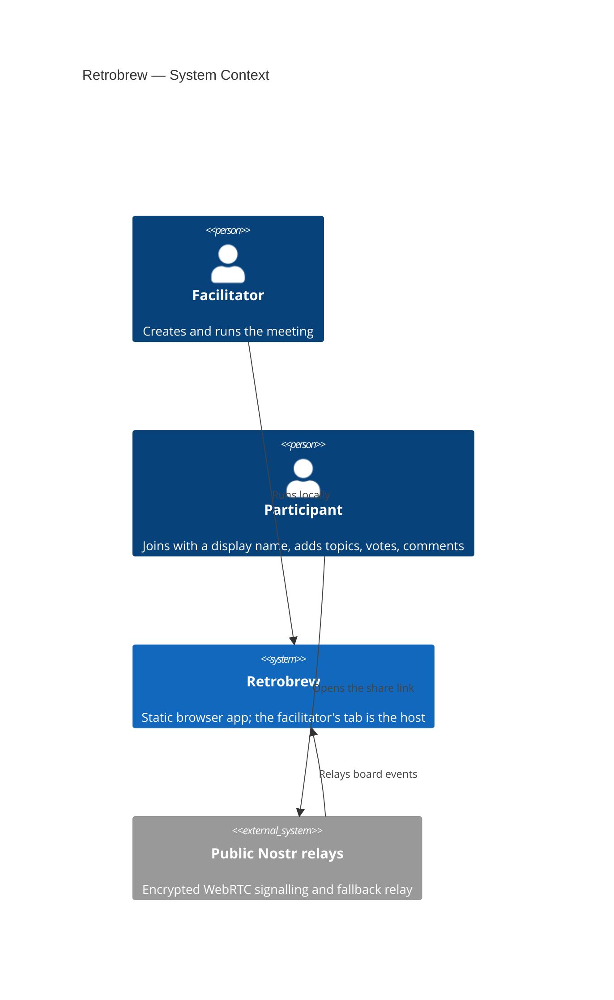

# Architecture

This document describes the high-level architecture of **Retrobrew**, a local-first Lean Coffee board that runs in the browser. Behaviour, screens and the sync protocol are specified in [docs/product/](docs/product/README.md).

---

## C4 — System Context

## Scope

Retrobrew runs Lean Coffee meetings: add topics, dot-vote, discuss on a timer, vote to continue, and copy the outcome. Other meeting formats are not built.

## Real-time model

Participants send commands (add topic, vote, move, start or end the timer, vote to continue, and so on) to the facilitator's tab, which validates them and broadcasts signed updates over a WebRTC star (Trystero, with Nostr signalling), with encrypted Nostr events as the fallback. See [sync-protocol.md](docs/product/sync-protocol.md).

- **Timer:** the facilitator's clock is the source of truth. The host broadcasts `endsAt`, and participants correct for clock offset.
- **Ordering:** topics use a fractional `position`; a dropped topic takes the midpoint of its neighbours.
- **Presence:** a heartbeat with a timeout keeps "Online" honest. Each ping carries its tab and a count, and the host accepts it once and only if it is fresh by its own clock, so a replayed ping keeps nobody online.
- **Reconnect:** after a drop, a participant is sent the whole board again, and the error banner clears by itself.
- **Participant follow:** some facilitator actions pull every participant's view along with them, such as phase changes. Everything else each participant browses freely.

## The app's screens

- **Design system first.** `design/system/` holds the tokens, the component styles (`components/bundle.css`), their types (`components/index.d.ts`) and a guideline per component. `src/ui/` ports each component to Preact with the same class names and props, so the system's stylesheet styles the app directly.
- **Rules as pure modules.** What the screens decide is written as small, tested functions in `src/app/`: the action bar's state table (`action-bar.ts`), Copy as text (`meeting-text.ts`, `counted-view.ts`), lengths and dates (`lengths.ts`), the time-up decision (`decision.ts`), the status strip (`status-strip.ts`), announcements (`announce.ts`), banners (`banners.ts`) and per-device preferences (`prefs.ts`).
- **One frame, three phases.** `MeetingScreen` serves facilitators and participants alike and shows `TopicsPhase`, `DiscussionPhase` or `EndedView`; `HostView` and `ParticipantView` only start the session and pass in its view and signals (detail in the next two sections).

## Share step

The facilitator's view opens a `Sheet` ("Invite people") once after a meeting is created (`takeJustCreated` in `src/app/handoff.ts`) and whenever they choose "Invite people". It shows a QR code of the share link, drawn in the browser by the bundled `uqr` library as one SVG path (`src/ui/qr-path.ts`), so no meeting link ever reaches a third party. `Sheet` is a native modal `<dialog>`; the page's single polite live region (`src/app/announcer.tsx`) moves into the topmost open dialog before it speaks, because inert content is never read out.

## The meeting frame

Facilitator and participants share one frame, `MeetingScreen` (`src/app/views/MeetingScreen.tsx`): the meeting name with the Rehearsal badge, the guide line for the viewer's role (`src/app/guide.ts`) with the "How Lean Coffee works" link (new tab), the facilitator line, "{n} here" opening the People sheet, `VoteBudget`, and `ModeSwitch` on wide screens (the People sheet holds it on phones, `useWide`). One `Banner` sits under the top bar. The words and priority of banners are `banners.ts`'s; `banner-choice.ts` maps a participant session to its signals and a banner to its tone. The People sheet (`PeopleSheet`, rows from `people.ts`) lists everyone, online first, and for the facilitator how each person is connected and the relays' "Connection details" (refusals, notices and, once above 0, "Oversize events"). The sound switch and the last timebox and extension are per-device choices in `localStorage` (`src/app/prefs.ts`, keys `rb-sound`, `rb-timebox`, `rb-extension`) that never leave the browser. `MeetingScreen` also owns which sheet is open (`SheetId`, one shared `opener` ref for focus return) and so opens the timebox picker (`TimeboxPicker`: a Segmented choice of the nine timeboxes, this device's last one preselected, "Use real minutes" on rehearsal boards, off each time it opens) and the time-up sheet (`TimeUpSheet` on the three-way `TimeUpVote`, words and the decision order in `decision.ts`). The time-up sheet opens by itself when the view's vote opens, closing any other sheet, and a "Vote" chip on the Discussing card reopens it; the page keeps its own ballot in memory by round, never in the board, a backup or a message. The timer sound is `src/app/sounds.ts` (four Web Audio sounds, no files; `listenForAudioUnlock` unlocks audio on the first tap of any kind, and "Take part" unlocks it too). `MeetingScreen` plays it from the effect that opens the time-up sheet, so once per vote key and never from the 250 ms tick, and the effect's first run only records the vote the first view already had, so nobody hears a vote they did not see open, and a page that wakes or rejoins more than 3 s (the host's clock, `STALE_VOTE_MS`) after the timer ended stays silent too. `playTimerSound` schedules nothing unless the audio context is running. The outcome line is `decision.ts`'s `outcomeLine`, written with the new timer's `minuteMs`, so a rehearsal board reads "Keeping going for 30 more seconds". The facilitator's countdown reads `HostSession.hostNow()`, the host's monotonic clock, so it never runs backwards when the system clock does. The facilitator's next step is `FacilitatorBar` over the pure state table in `action-bar.ts` (`barRow`, then `phoneBar` or `wideBar` for the layout): a dock on phones, whose height `useInset` publishes as `--mtg-bottom` so the page pads itself and sets scroll-padding, and a stacked block at the top of a "Facilitator" side panel on wide screens, with `FacilitatorControls` below it (the end of the "More" sheet on phones). `Confirmations` holds Reset all votes, End meeting (with Copy as text, which copies without closing it and shows a field to copy by hand if the clipboard is refused) and Back up meeting file, which the save banner's "Back up" also opens; a control inside a sheet that opens another sheet leaves focus return to the page button that began it. Once the meeting has ended `MeetingScreen` shows `EndedView` (the `EndedSummary` list, with `finalLists` from `meeting-text.ts`) in place of both phases, with no topic actions (`TopicItem` offers none on an ended board), and a banner "Meeting ended · {date}": a participant's always wins and carries Copy as text, the facilitator's gives way to a banner about saving or the network. The facilitator's Copy as text reads `HostExtras.countedView` (`counted-view.ts`: the host's board with Show votes forced on, so every real count is written, in the topics phase too), which is never drawn or sent; a participant copies from their own view, which shows every count once the meeting has ended. The outcome line shows in the discussion phase only. When the meeting ends and takes away the focused control, focus goes to the page's `[data-focus-fallback]`: the facilitator's primary button, or the participant's Copy as text.

Everything before a board sits in `StatePage` (`src/app/views/StatePage.tsx`: the wordmark, `ModeSwitch` and one panel): the participant's join form, connecting panel (`connectingCopy`) and version-mismatch banner, the facilitator's starting, failed, open-in-another-tab and taken-over states, and the broken-link page. A pre-board banner uses the same `Banner` and action words as the board, so Retry and Reload work there too. The device remembers per meeting that it has joined, and under which name, in `localStorage` (`src/app/joined.ts`, key `rb-joined:{boardId}`, value the name with the link's facilitator key `hostPub`, written once the host lists this person as an attendee; a link whose `h` differs never rejoins silently), so a reload or the link opened again skips the form and rejoins silently; the name never leaves the browser. A first view that is already the ended view moves focus to the page's `[data-focus-fallback]` only when the person had just used Take part or Retry and focus is on the body; a silent rejoin moves none. A refused join brings the form back with the name field focused and selected, and a refused silent rejoin forgets the stored name. `joined.ts` keeps the 20 most recent meetings (order in the key `rb-joined-order`). One `Announcer` wraps every participant state so the live region never remounts. The facilitator's hosting-state pages each have an `h1`. Browser tests force banner signals and the facilitator's starting and failed states through the tab's sessionStorage (`src/app/test-hooks.ts`, key `rb-e2e-force`); the read, and the message of the forced start failure (`forcedStartError`), sit behind `import.meta.env.MODE === 'e2e'`, and `check:assets` fails any other build that carries the key or the message.

## Storage layout

Each board lives in the facilitator's browser: an append-only event log plus periodic snapshots in IndexedDB, with JSON export/import as the durable backup. The store and the backup file carry a version (IndexedDB 3, backup file 2): boards saved before sync protocol 3 are dropped when the database upgrades, and a version 1 backup file is refused on import with a message to start a new meeting. The meeting record also notes whether `navigator.storage.persist()` was granted when the meeting was created (`BoardRecord.persistence`), which drives the facilitator's storage banner. Database version 3 adds a `joined` store: the meetings this device joined as a guest (name, share link, the name used, when), for "Your meetings"; it holds no board, is never exported and is not part of any message.

## Why this works

With no accounts and no server, there is nothing to sign up for, host or pay for: the facilitator's tab is the authority and the relays carry only encrypted events.

### Known or potential issues

- Public Nostr relays have no SLA and may rate-limit; the end-to-end tests include a smoke run against the real public relays (`npm run test:e2e:public`).
- Some networks block direct WebRTC; those participants use the relay path, which measured p50 181 ms / p95 258 ms round trip on the default relays. The direct/relayed split in real meetings is not measured. A browser with no WebRTC at all (or where Trystero fails to start) uses the relay path alone, as host or participant. Trystero re-forms a dropped direct connection only at a peer's next announcement, once a minute, so a page that comes back from a lock having lost a link it cares about (a participant's to the host, any of the host's) rejoins the direct room to announce itself at once. The session names the host's peer for the transport's resume, and at all times (`follow`), so a participant whose link to the host drops while it is visible rejoins once, not within a minute of any rejoin (the host's own rejoin may leave its old connection live on the participant's side, where Trystero ignores the host's announcements until it closes); the transport tracks the page's visibility itself, and the signalling URLs a rejoin retires, and the direct rooms open or being left, are recorded for the whole page, as Trystero keeps its signalling clients for the whole page and gives every room joined while another is open the same ones. A rejoin closes the connections of peers its room reported gone that are not connected, or have been gone over 5 s (Trystero keeps them as shared connections and would give a dead one to the new room), and rejoins up to twice more, 10 s and then 26 s later, if a lost link is still missing (`docs/product/sync-protocol.md`, Direct path after a resume).
- Safari may delete browser storage after 7 days without a visit, so export matters.
- If the facilitator's tab is gone, the board is read-only until it returns. A running timer keeps going on the host's clock and time's up appears when the host is back. A guest's identity is their device key, so a new browser means a new identity.
- Removing someone only disconnects them; they can rejoin from the link. Whether to block them is undecided.
